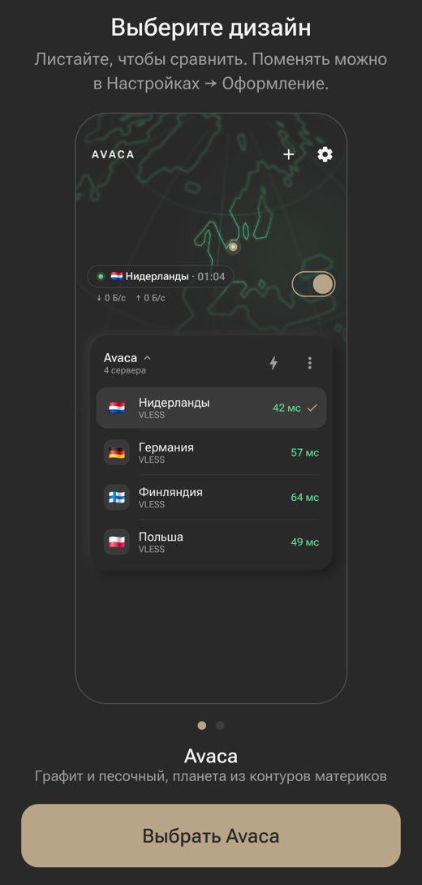
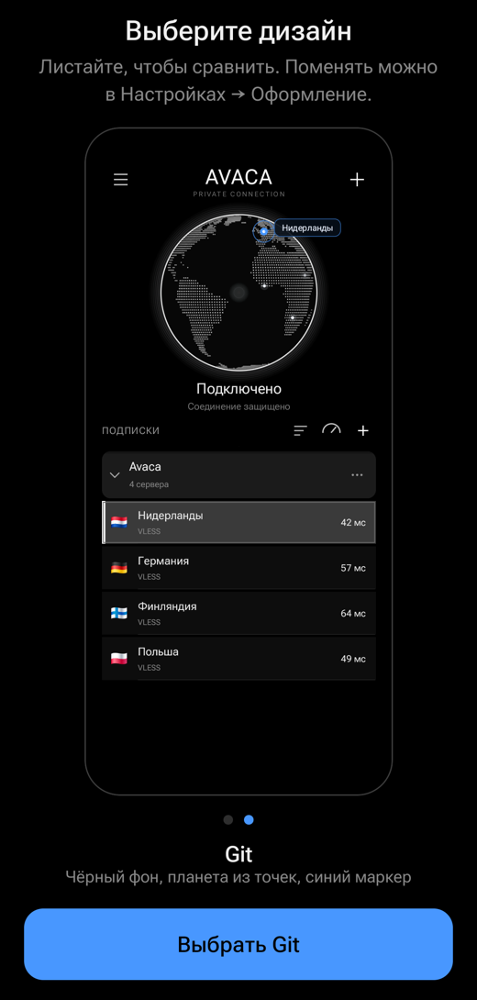
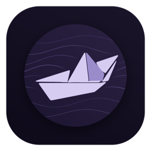

<div align="center">


# Avaca

**VPN-клиент для Android на ядре Xray с транспортом OpenFlux**

Подписки Remnawave и других панелей, JSON-конфиги провайдера без потерь,<br>обход белых списков через OpenFlux и два дизайна на выбор.

<br>

[](https://github.com/QJEqq/avaca/releases/latest)
[](https://github.com/QJEqq/avaca/actions/workflows/build.yml)
[](#установка)
[](https://github.com/XTLS/Xray-core)
[](LICENSE)

<br>

### [Скачать последнюю версию](https://github.com/QJEqq/avaca/releases/latest)

[Возможности](#возможности) &nbsp;·&nbsp; [Дизайн](#дизайн) &nbsp;·&nbsp; [Установка](#установка) &nbsp;·&nbsp; [Сборка](#сборка-из-исходников) &nbsp;·&nbsp; [Приватность](#приватность) &nbsp;·&nbsp; [English](README.en.md)

<br>


&nbsp;&nbsp;&nbsp;


</div>

## Возможности

**Подписки**
- Ссылки, списки в base64 и JSON-документы Xray; добавление по ссылке, из буфера, по QR-коду и ссылками `happ://` и `avaca://`.
- Заголовки провайдера: объявление, трафик и срок, поддержка, страница профиля, интервал обновления, фрагментация, Mux, запасной адрес, переезд по `new-url` и `new-domain`.
- Лимит устройств панелей вроде Remnawave: случайный идентификатор установки `x-hwid`.

**JSON провайдера как есть**
- Сервер из JSON-документа уходит в ядро целиком: outbound, цепочки `dialerProxy`, маршруты и DNS документа.
- XHTTP `extra`, Final Mask (`fm`), закрепление сертификата — и из JSON, и из ссылок.

**Протоколы и транспорты**
- VLESS (REALITY, XTLS Vision, XUDP), VMess, Trojan, Shadowsocks (включая 2022), Hysteria2, WireGuard, HTTP, SOCKS5.
- TCP, WebSocket, gRPC, HTTPUpgrade, XHTTP, mKCP; uTLS-отпечатки, ALPN, SNI.
- **OpenFlux** — транспорт для сетей, где пропускают только разрешённые сервисы. Каналы для пользователей выдаёт [Supwave](https://github.com/QJEqq/supwave) — дополнение к Remnawave.

**Маршрутизация**
- Режимы маршрутизации, свои правила (через VPN / напрямую / блок): домены, ссылки, `geosite:`, IP и подсети, `geoip:`.
- Раздельное туннелирование по приложениям, блокировка рекламы и QUIC, обход локальной сети.

**Устойчивость**
- Автопереключение на живой сервер и возврат на выбранный, когда он оживёт.
- DNS через DoH с подменой упавшего резолвера, параллельные запросы к DNS провайдера и к своему.
- Резолв адреса сервера через DoH, Mux, фрагментация ClientHello.

**Для тех, кто держит свои серверы** (режим разработчика)
- Диагностика по шагам: DNS → DoH → TCP → TLS/REALITY → трафик → DNS в туннеле → внешний IP.
- Итоговый конфиг Xray, уровень логов ядра, журнал соединений: куда ушло каждое соединение.

## Дизайн

При первом запуске приложение предлагает выбрать дизайн свайпом; поменять его можно в **Настройки → Оформление**.

- **Avaca** — графит и песочный, планета из контуров материков.
- **Git** — чёрный фон, планета из точек, синий маркер сервера.

Семь иконок приложения на выбор:

<table>
  <tr>
    <td align="center"><br><sub>Уголь и пепел</sub></td>
    <td align="center"><br><sub>Тёмный изумруд</sub></td>
    <td align="center"><br><sub>Полночный синий</sub></td>
    <td align="center"><br><sub>Бордо</sub></td>
    <td align="center"><br><sub>Бронза</sub></td>
    <td align="center"><br><sub>Тёмная слива</sub></td>
    <td align="center"><br><sub>Хвоя и песок</sub></td>
  </tr>
</table>

## Установка

APK лежат в [релизах](https://github.com/QJEqq/avaca/releases/latest):

| Файл | Для чего |
| --- | --- |
| `avaca-<версия>-arm64-v8a.apk` | почти все телефоны последних лет |
| `avaca-<версия>-armeabi-v7a.apk` | старые 32-битные телефоны |

Нужен Android 8.0 или новее. Сборки подписаны одним ключом; отпечаток сертификата (SHA-256):

```
B2:D5:DF:F5:85:47:AD:58:05:C9:46:23:D3:88:3A:5F:C6:53:02:C2:B1:B5:EE:14:5F:ED:39:E8:A3:C7:89:52
```

Проверить: `apksigner verify --print-certs avaca-*.apk`.

## Сборка из исходников

```bash
git clone --recurse-submodules https://github.com/QJEqq/avaca.git
cd avaca
tools/build-core.sh            # ядро → shared/libs/avacacore.aar (нужны Go, gomobile, NDK)
./gradlew :app:assembleDebug
```

Без Go можно взять готовое ядро `avacacore-<версия>.aar` из релиза и положить в `shared/libs/avacacore.aar`.
Подробности — в [DEVELOPMENT.md](DEVELOPMENT.md).

## Приватность

Нет аналитики, рекламы, аккаунтов и отчётов о сбоях. Подписки, серверы, настройки и журнал хранятся только на телефоне.
Приложение обращается только к серверам, которые вы добавили, и к нескольким служебным адресам — список в [PRIVACY.md](PRIVACY.md).

## Основано на

- [Yumi](https://github.com/GXUser7/yumi) — Avaca начиналась как форк Yumi: модель данных, разбор ссылок, сборка конфигурации Xray, привязка ядра.
- [Xray-core](https://github.com/XTLS/Xray-core) — ядро туннеля.
- [OpenFlux](https://github.com/p1neappleXpress/OpenFlux) — транспорт; используется [форк](https://github.com/QJEqq/OpenFlux/tree/avaca-0.17) с исправлениями для Android.
- [v2fly/geoip](https://github.com/v2fly/geoip) и [v2fly/domain-list-community](https://github.com/v2fly/domain-list-community) — базы маршрутизации, скачиваются при первом запуске.

Полный список сторонних компонентов и их лицензий — [NOTICE.md](NOTICE.md).

## Лицензия

[GPL-3.0](LICENSE), как у Yumi и OpenFlux. Ошибки и предложения — в [issues](https://github.com/QJEqq/avaca/issues); уязвимости — по [SECURITY.md](SECURITY.md).
